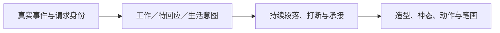

# 小湛工作与生活的表演语法 v0

2026-10-29，讨论稿。用户认可上一轮节奏有所改善，但指出潜水消失、整段变化仍少，要求先拆分事件计时与动画节奏，再观察进行中会话的密集工具切换及 ?／!。本稿用于确定下一轮分镜范围，不代表新表演已获体验确认。

用户随后授权按此方向制作，并在观看后确认“整体观感可以”。[集中工作／生活分镜](little-deep-work-life-v0.md)与[连续对照](../art-workflow/whale-little-deep-v3/work-life-study.html)作为当前表演基线；生活交互、隐身等后续增强。本稿继续保留分层依据及库盘点，尚未制作的能力仍分别验收。

## 问题来自哪里

潜水消失主要由映射造成：原版本把 thinking 与 working 逐次转换成潜入／浮出，默认压缩回放有 42 段潜入；修订又把潜水绑定连续 4 秒屏幕计时。8 倍回放中持续状态不断被打断，于是几乎没有潜水。后一门槛已撤销。潜水造型、扫摆与侧转能力仍在角色库，没有删除。

变化少还有两个原因：结构投影只保留少数 mood、工具数量与请求，丢掉了实时 reasoning／文字流的阶段区别；现有三种完整鲸鱼动作主要差在视线、眼睑、侧倾与划鳍，轮廓及构图相近。不是原始会话没有丰富事件，也不能靠增加几个眨眼解决。

## 不给每条事件分配独立表演

原始事件负责事实，行为意图决定意义，表演编排决定可读节拍，角色库提供身体能力。

| 事件／意图 | 应表达什么 | 是否单独演一段 |
| --- | --- | --- |
| 投递回执、步骤边界、同步与 job 记账 | 更新事实及归属 | 否，不重播接到工作 |
| 模型生成／明确 reasoning 信号 | 收集线索、集中处理 | 进入工作段落；不按 token 或每一步重新潜入 |
| 读写、执行与工具结果 | 持续执行，必要时局部强调不同操作 | 一组工具共用段落，短间隙保持动势；不每次重演全身动作 |
| 公开过程说明与回复 | 浮出向用户说明，随后仍可继续工作 | 可读的汇报节拍；不等于完成 |
| 正式 ?／! | 需要用户回应或决定 | 独立且优先，按完整身份进入／结算；沿用已确认表演 |
| 工具局部失败 | 遇到小阻力并继续处理 | 短反应候选；不等于回合失败 |
| 回合结束／共享完成判断 | 普通收势、目标继续或确认完成 | 必须分支；只有确认完成进入庆祝 |

“潜入专注”可以是集中工作段的姿态，不能同时承担“已确认模型长考”的技术断言。真实 reasoning 信号也不要求每次都触发大形变。建议下一轮比较：开始集中工作时潜入一次，在密集 thinking／tool 往返中留在当前工作段，以尾鳍节律等局部变化承接；出现真实汇报或用户请求时浮出。段落出口和新一段工作入口由当前意图及可打断的表演共同决定，不读取未来，不凭固定秒数判断长考。

## 表演库是否足够

[角色本体](../art-workflow/whale-little-deep-v3/character.js)已有 19 项动作，含持续状态、完成／出错、藏尾／探出、喷水、摆尾、潜游、露腹、泡泡和触碰；[主线局部动作](../art-workflow/whale-little-deep-v3/work-activities.js)另有接收、凝神、做事、回复与收势。数量足以制作下一轮短分镜，但不等于已有完整且可复用的表演段落。

| 能力 | 现状 | 优先补什么 |
| --- | --- | --- |
| 轮廓与尾巴 | 已有完整鲸鱼／实心尾巴及明显扫摆、侧转 | 保留，不重画角色 |
| ?／! | 局部出场、结算与基本交互已获确认 | 验证来自真实会话的竞争与恢复 |
| 集中工作循环 | 有原始 thinking、working 和三个表面工作动作 | 缺一个不随工具抖动、能持续潜入并适时浮出的工作段落 |
| 过程汇报与恢复 | 有 replying，主线微姿态区别较小 | 缺清楚的“暂时向你说明 → 回到手头工作”表演 |
| 阻力／停止 | 有基础 error、blocked | 缺局部失败、全局失败、取消／停止的不同出口 |
| 生活动作 | 有招呼、藏尾探出、露腹、泡泡、睡眠等素材 | 缺自主意图、活动段落和退让衔接；未接入本分支 NPC |

先补工作循环与工作／生活交接，再扩写动作数量。19 项基础动作中，只有 ?／! 当前局部样片已有用户体验确认；其他素材和新组合仍各自评审。

## 如何一眼区分工作与生活

区分行为目的、空间和节奏，不只靠一张不同表情或一个状态标签。

| 维度 | 工作 | 生活 |
| --- | --- | --- |
| 注意对象 | 朝向当前任务，有明确专注与汇报方向 | 看用户或环境，允许松散观察 |
| 身体主姿态 | 收鳍、前探或集中潜入；阶段清楚 | 舒展、侧卧／露腹、探看、休息 |
| 动势 | 克制、有节律、保留进行中的事情 | 缓急有变化，带停顿和好奇回应 |
| 空间 | 围绕工作锚点，不边做任务边随机玩耍 | 在允许的活动区探访、观察、回窝 |
| 大动作 | 用在工作段落、汇报、求助与完成边界 | 用在招呼、探索、玩耍及休息段落 |
| 拥有权 | 活跃任务、?／!、用户交互优先 | 工作或用户占用到来即退让，不补播被取消的旧动作 |

生活段落需服从[现有陪伴契约](../../companionship-contract.md)的许可、工作占用与退让，不能因几秒没有工具就启动生活。工作中的尾巴专注与生活里的藏尾玩耍，即使复用同一造型，也须用不同起势、持续节律和出口区分。当前独立原型没有把既有 NPC 策略接入，不能凭样片宣称生活能力完成。

## 两种时钟与现场观察

`work-loop.js` 已拆开 `advanceEventTime(ms)` 和 `advance(seconds)`。前者接收源时间并计量事实阶段，后者只推进动作、笔画、最小可读停留与淡出；其中 1.4 秒停留和 0.8 秒划鳍桥接是表演参数，不是模型阶段判定。单独推进一边不会快进另一边。没有计时器会自行产生“长考”或结算请求。

用户新建 `session-784ffb57-6579-4b21-9fb8-be69d164c65a`，已在进行中只读观察并跟随至结束。观察器使用当前 Model、Broker 和提问投影，页面独立推进动画。该会话的 `ask_user_question` 是 legacy 阻塞工具，没有 timed-question 公开投影；当前按真实调用到结果的完整身份区间观察，并在原生界面核对两个待答问题。它不替代正式 Host 的请求回调；流式 reasoning／文字增量及 Agent 存活还未由此观察器接入。

| 现场事实 | 本轮核对 |
| --- | --- |
| 首个问题 seq 78 → 79 | 接入时已等待，核对当前等待恢复；用户答复后的结算与继续工具在接入后捕获，不把接入前的出场当作现场新演出 |
| 密集工具与继续 | 全会话 29 次调用；接入后捕获 14 次新调用及对应后续事实，角色从当前姿态承接 |
| 审批 seq 127 → 128 | 原生界面确认一次只读命令的提权请求；用户选择拒绝，感叹号退出，继续处理。一次工具 isError 未变为整轮失败或庆祝 |
| 第二个问题 seq 138 → 139 | 新 call id 独立进入，原问号和感叹号不残留；用户选择结束后结算 |
| 回合结束 seq 158 | 共 159 条事件、20 步；共享分类为普通 reply、无目标，active=false、工具与请求均清零，回到陪伴、不喷水 |

该轮主线／既有机制 53 项、日志观察器 3 项检查通过；随后工作／生活对照另加 10 项段落机制检查。现场没有执行允许审批分支、并存混合请求、实时 reasoning 流或新工作／生活表演；这些不记为现场通过。记录只保存元数据与本地画面，不复制会话正文、命令参数、工具输出或推理文本。
